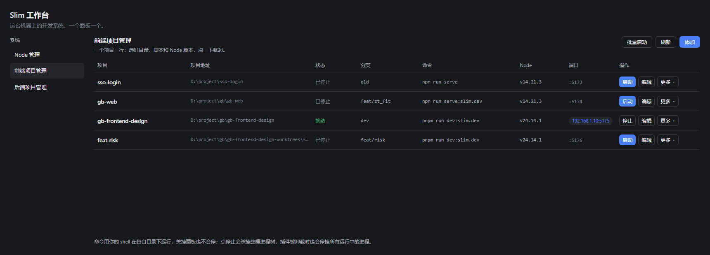
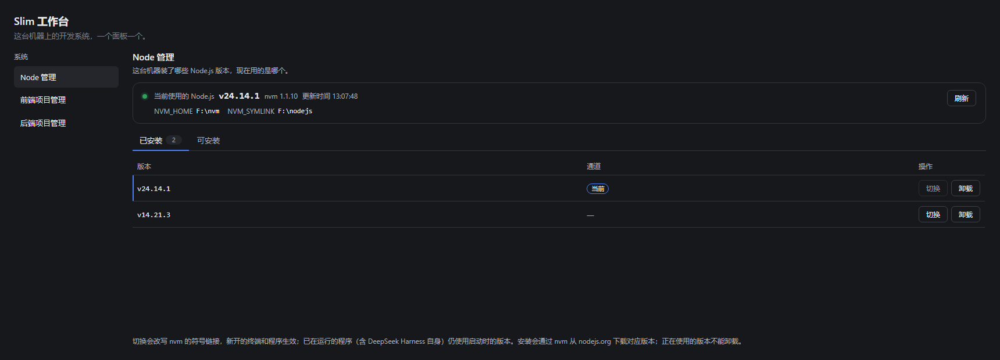

# Slim workbench

**Stop hopping between five terminals.**

Which dev server is up, on which port, on which branch, running which Node — one panel shows it all.
It lives in the sidebar and opens instantly; it never starts anything by itself.

## 🧩 Three systems, one panel

### ⚙️ Node management

The versions nvm-windows manages, with the one in use marked; switching, installing and removing all
happen here. The version in use can be neither switched away from nor removed — clicking it says so
instead of leaving a dead grey button — and removing asks first, showing **the folder that will be
deleted**. On macOS and Linux the pane lists versions only (there a version belongs to a shell) rather
than pretending a machine-wide switch exists. **Refresh** re-reads what is installed on this machine
only; it does not re-fetch the release index.

### 🖥️ Frontend projects

Pick a folder → it reads that folder once and offers every `scripts` entry → **you** choose the package
manager and the script (neither is preselected; a lockfile is a hint, never applied for you).
When the port answers the row says *ready* and gives the LAN address to hand to a phone or a colleague.
Pin a Node version per entry — that affects this launch only, never your global `nvm use` — and a port.
**Batch start** runs in parallel by default; the second mode starts them one at a time, each after the
previous one answers on its port, in list order, for projects that must come up in sequence.
The same folder may be added more than once: one entry per script of a monorepo, because script, port,
and Node version are per entry. A row shows two actions (start/stop, edit); output and delete live
under **More**.

### ☕ Backend projects

Spring Boot: pick Maven or Gradle, the profile comes from the project's own `application-*.yaml`, and
the port is read from `server.port`. The profile travels as `SPRING_PROFILES_ACTIVE`, so
`spring-boot:run`, `bootRun`, a fat jar, and your own command all work. A complete wrapper is preferred
(half a `mvnw` cannot even build, which is worse to debug); otherwise the global `mvn` / `gradle`.
Backends compile, so their readiness budget is 5 minutes against the frontend's 3.

## 🛡️ It does not touch your project

Not a promise — a test:

- The project directory is **read-only**: manifests, lockfiles, `.nvmrc`, `pom.xml` / `build.gradle`,
  `application-*.yaml`, plus two read-only git commands
- Those git calls carry `--no-optional-locks`. Without it, `git status` refreshes its stat cache and
  **rewrites `.git/index`** — a file inside your project. A test compares the sha256 of `.git/index`
  before and after
- **No writes, no new files, no renames, no deletes** inside a project; no dependency installs; no
  lockfile or config edits; no mutating git command
- It kills only processes it started
- It writes one file: `~/.dsh/slim-workbench/launchers.json`

## 🧯 Stopping reaches the whole tree, and a crash is recoverable

On Windows every run goes into a job object (`KILL_ON_JOB_CLOSE`): a grandchild that detached itself
through `start /b` is still inside it, and if this host dies the tree dies with it. When the job cannot
be created it falls back to `taskkill /T`; POSIX uses process groups.

Should a process outlive the host anyway (a platform without job objects, say), the next start adopts
it when **the pid is alive and its command line still matches**, marks the row *adopted*, and one Stop
still clears the tree. A reused pid is never mistaken for ours.

## 🤖 The model gets two tools

- `node_version` — look up, switch, install, remove Node. These change the whole machine, so they run
  only when you ask for them by name
- `workbench_status` — **read-only**: entries, run state, ports, branches, warnings, and the last lines
  each run printed. It answers "why did my dev server stop" without ever starting or stopping anything

## 🚀 Getting started

1. Click **Slim workbench** in the sidebar
2. Check the current version under **Node management** (it works without nvm installed)
3. **Frontend projects → Add**: pick a folder, pick a script, **Save and start**

## 📦 Where the data is

One entry stores: the absolute project path, the command conditions you chose, a port, a priority,
whether it takes part in a batch start, and a small inspection snapshot (branch, port, warnings).
No sources, no secrets, no environment variables.

`launchers.json` beside it has three sections: `entries` (your launchers), `nodeCache` (the last Node
read, kept only so a failed live read still has something to show), and `runs` (what is running, used to
adopt processes after a crash). A fresh install starts empty; copying that JSON to another machine
brings the entries over, with paths pointing at that machine's checkouts.

Reading a project happens only when an entry is saved, when its editor opens (the dialog re-reads the
script list and the profiles, showing a loading state), or from **Refresh** above the list. Opening the
panel reads one JSON file, so it is instant and never calls `git`.

## 🧭 Worth knowing

- A machine-wide Node switch needs nvm-windows; on macOS and Linux this pane lists versions and says
  where to switch instead
- The backend pane runs development targets only (`spring-boot:run`, `bootRun`); it does not build a jar
  first and does not manage Java versions
- Logs live in memory only (a 64 KB ring buffer per run, colour codes stripped); nothing is written to
  disk, and a process started before this plugin loaded has no output to show. A failed start shows the
  **last line**, and **Output** shows the last 200
- Priority is editable and stored, but **nothing consumes it yet**: the start order is the list order,
  and the field's own hint says so
- The install tab reads `https://nodejs.org/dist/index.json` and caches it for ten minutes; installs go
  through nvm. Nothing else leaves the machine

> The previews above are rendered by this plugin's own `client.js` in a local browser (sample data).
> `npm run visual -- --docs` regenerates them, so they cannot drift away from the real panel.
