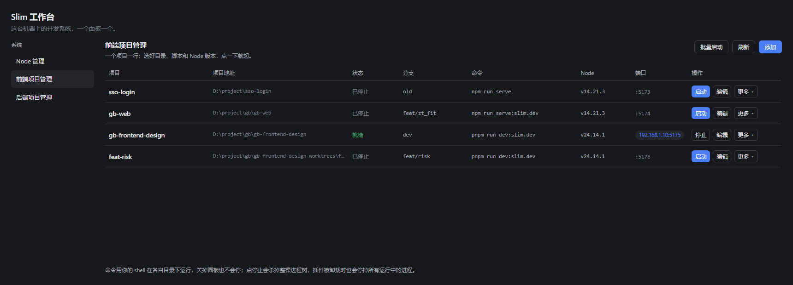
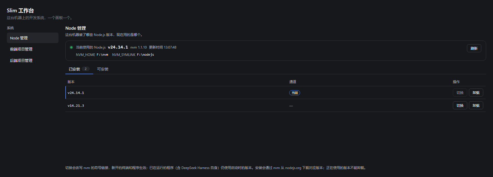

# Slim 工作台

**不用在五个终端之间来回切了。**

哪个 dev server 起来了、占着哪个端口、在哪个分支、用的是哪个 Node —— 一个面板看完。
面板常驻侧边栏，点开就有，它自己不会启动任何东西。

## 🧩 三个系统，一个面板

### ⚙️ Node 管理

nvm-windows 管着的版本，一眼看到当前用的是哪个；切换、安装、卸载都在这一页。
正在用的版本不能切走也不能卸载 —— 点它会直接告诉你先切换，而不是留一个点了没反应的灰按钮；
卸载前先弹确认，框里写着**会被删掉的那个目录**。
macOS / Linux 上这页只列出版本（那里版本属于 shell），不会假装能全机器切换。
「刷新」只重读**本机已安装**的版本，不会跑去 nodejs.org 拉列表。

### 🖥️ 前端项目

选目录 → 它读一次 `package.json`，把 `scripts` 全列出来 → **你自己选**包管理器和脚本
（两者都不预选，锁文件名只当提示显示在旁边，不会被自动套用）。
启动后端口一应答就是「就绪」，附一个局域网地址，可以直接发给手机或同事。
单条可以锁定 Node 版本 —— 只影响这一次启动，不动你的全局 `nvm use`；也可以指定端口。
**批量启动默认并行**；需要按顺序起的项目（比如 SSO）切成「逐个启动」，按列表顺序等上一条端口就绪。
同一个目录可以加多条：monorepo 里几个子项目的脚本不同，就各一条，脚本、端口、Node 版本都按条目记。
每行只有两个按钮（启动/停止、编辑），输出与删除收进「更多」。

### ☕ 后端项目

Spring Boot：Maven / Gradle 二选一，Profile 从项目自带的 `application-*.yaml` 读成下拉，
端口从 `server.port` 读出并预填。
Profile 通过 `SPRING_PROFILES_ACTIVE` 传下去，所以 `spring-boot:run`、`bootRun`、胖 jar、
以及你手写的命令都通吃。项目自带完整包装器时优先用它（半份 `mvnw` 连构建都到不了，用起来更难查）。
后端要编译，比 dev server 慢，就绪预算因此放宽到 5 分钟（前端 3 分钟）。

## 🛡️ 它不碰你的项目

不是口号，是测试里钉住的：

- 项目目录**只读**：清单、锁文件、`.nvmrc`、`pom.xml` / `build.gradle`、`application-*.yaml`，加两条 git 只读命令
- 那两条 git 带着 `--no-optional-locks`。不加的话，`git status` 会在缓存过期时**改写 `.git/index`** ——
  那是项目里的文件。测试比对读取前后 `.git/index` 的 sha256
- **不写、不新建、不改名、不删除**项目里任何文件；不安装依赖；不动锁文件与配置；不做写操作的 git
- 只停它自己启动的进程
- 只写一个文件：`~/.dsh/slim-workbench/launchers.json`

## 🧯 停止是整棵树，崩了也能收尸

Windows 上每个运行都放进一个 job object（`KILL_ON_JOB_CLOSE`）：`start /b` 之类自己 detach 出去的
孙进程也跑不掉；宿主被强杀时，整棵树跟着死。job 起不来就退回 `taskkill /T`，POSIX 用进程组信号。

万一还有进程活过了宿主（比如 job 不可用的平台），重启后按 **pid 还活着 + 命令行对得上** 两个条件认领，
行里显示「接管」，一次「停止」照样清掉整棵树；pid 被别的程序复用时不会误认。

## 🤖 智能体也有两个工具

- `node_version` —— 查 / 切 / 装 / 卸 Node。这些动作改的是整台机器，所以只在你要它做的时候执行
- `workbench_status` —— **只读**：条目、运行状态、端口、分支、警告、每个运行的最后几行输出。
  它能回答「我的 dev server 为什么停了」，但不能替你启动或停止 —— 起一个长驻进程始终是用户动作

## 🚀 开始用

1. 侧边栏点「Slim 工作台」
2. 「Node 管理」确认当前版本（没装 nvm 的机器也能看）
3. 「前端项目管理 → 添加」：选目录、选脚本，「保存并启动」

## 📦 数据在哪

一条条目只存：项目**绝对路径**、你选的命令条件、端口、优先级、是否参与批量、一份很小的探测快照
（分支、端口、警告）。没有源码、没有密钥、没有环境变量。

同目录的 `launchers.json` 里三段：`entries` 是你的条目，`nodeCache` 是最后一次 Node 读取的快照
（只为实时读取失败时还能显示上次结果），`runs` 是正在跑的进程记录（宿主崩溃后用来认领）。
新装插件的列表是空的，把这个 JSON 拷到另一台机器就能把条目带走 —— 路径要改成那台机器上的位置。

读取项目只发生在**保存条目**、**打开编辑弹窗**（会重读脚本与 profile，读的时候下拉是 loading）
或**列表上方的「刷新」**（一次重读全部条目）时。打开面板只读一个 JSON，所以秒开，也不会去调 `git`。

## 🧭 值得知道的边界

- 全机器切换 Node 需要 nvm-windows；macOS / Linux 上这一页只列版本并说明去哪里切
- 后端页只跑开发目标（`spring-boot:run`、`bootRun`），不会先打包 jar，也不管理 Java 版本
- 日志只在内存里（每条 64 KB 的环形缓冲，已剥离终端颜色码），不落盘；插件加载之前就在跑的
  进程，输出看不到。启动失败时行内显示**最后一行输出**，点「输出」看最后 200 行
- 优先级**能填能存**，但**目前没有消费方**：启动顺序就是列表顺序，输入框下面也这么写着
- 「可安装」页读取 `https://nodejs.org/dist/index.json` 并缓存十分钟，安装经 nvm 下载；除此之外不外发数据

> 上面的预览图由插件自己的 `client.js` 在本机浏览器里渲染（数据是示例），
> 用 `npm run visual -- --docs` 可以重新生成 —— 所以它们不会和真实界面走散。
